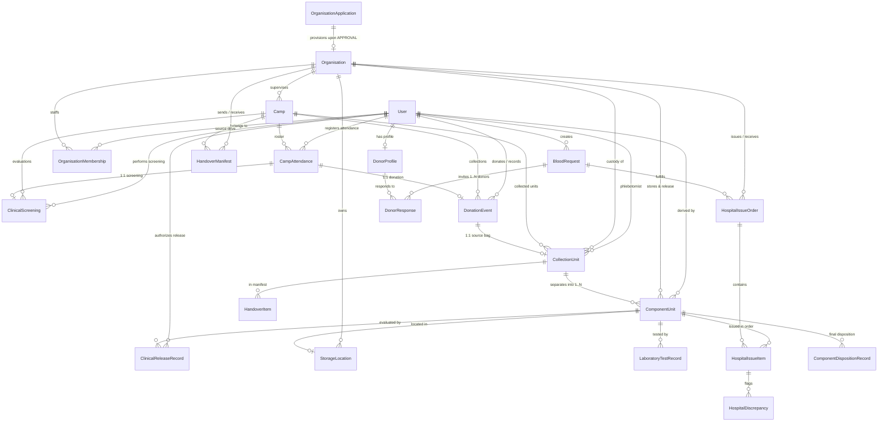

# RaktaSetu — Synthetic Demo Data Relationship Map & Architecture

**Document Purpose:** This document explains the exact relational data structure, entity lifecycles, and relational foreign-key dependencies underpinning the RaktaSetu synthetic dataset. All relationships directly reflect the PostgreSQL / Neon schema in `prisma/schema.prisma`.

---

## 1. End-to-End Entity-Relationship Diagram

---

## 2. Core Relational Lifecycles Explained

### 1. Identity, Organisation Membership & Boundary Isolation
- **`User`** represents a single human identity, uniquely keyed by canonical E.164 phone number (`phoneNumber`).
- **`Organisation`** represents an accredited institutional legal entity (blood bank or receiving hospital), uniquely identified by `orgCode` and `licenseNumber`.
- **`OrganisationMembership`** binds a `User` to an `Organisation` with an explicit role:
  - `ORG_ADMIN`: Administrative lead, staff provisioning, camp supervision.
  - `INVENTORY_STAFF`: Laboratory separation, location storage movements, manifest reconciliation.
  - `CLINICAL_STAFF`: Clinical donor screening, infectious marker lab verification, clinical component release.
  - `COLLECTION_STAFF`: Mobile camp phlebotomy, walk-in registration, bag tagging.
  - `AUDITOR`: Immutable read-only compliance auditor.
- **Data Isolation Invariant:** Every query in the organisation portal filters strictly on `organisationId`. A staff member of `DEMO-ORG-PUN-001` cannot read, modify, or issue units belonging to `DEMO-ORG-PUN-002`.

### 2. Onboarding: Application to Verified Organisation
- A self-service applicant submits an `OrganisationApplication` (`status: SUBMITTED`).
- A Platform Admin (`User.role === 'ADMIN'`) evaluates the application.
- Upon approval (`PATCH /api/v1/organisations/applications/:id/review`):
  1. `OrganisationApplication.status` transitions to `APPROVED`.
  2. `Organisation` is upserted with `status: VERIFIED`.
  3. The applicant's `User` account is atomically granted `OrganisationMembership` with `role: 'ORG_ADMIN'`.
  4. The applicant can now immediately sign in at `/organisation/login` and access the portal.

### 3. Camp Proposal to Public Discovery
- Community organizers propose camps at `/organisation/register-camp` (`status: PROPOSED`), selecting a licensed parent blood bank from verified organisations in PostgreSQL.
- **Public Concealment:** The public camp directory (`/camps`) strictly filters for `status: 'APPROVED'`. Unapproved proposed camps remain completely invisible to the public.
- The parent blood bank reviews and approves the proposal (`PATCH /api/v1/camps/:id/status` -> `APPROVED`).
- The camp is now publicly visible, grouped under "This Week", "This Month", or "Upcoming", badged with the parent blood bank's accreditation.

### 4. Camp Phlebotomy, Screening & Collection Units
- A donor arrives at the camp. Collection staff logs check-in (`CampAttendance.status: 'CHECKED_IN'`).
- Authorised `CLINICAL_STAFF` records informed consent and conducts medical screening (`ClinicalScreening.status: 'CLEARED'`).
- **Safety Invariant:** A donor with a deferred screening decision (`DEFERRED`) cannot have a completed donation event committed.
- When donation succeeds, `DonationEvent` is committed (`outcome: 'COMPLETED'`).
- A physical `CollectionUnit` (source blood bag, e.g., `CU-DEMO-PUN-001`) is tagged 1:1 with the donation event, capturing volume, bag identifier, and phlebotomist signature.

### 5. Custody Handover & Manifest Reconciliation
- Mobile collection units are packaged into temperature-controlled cold shippers.
- Collection staff drafts and dispatches a `HandoverManifest` (`DEMO-HM-2026-001`) with transit details (driver contact, seal verification, departure temperature).
- Upon physical arrival at the blood bank receiving dock, receiving inventory staff verifies each `HandoverItem`:
  - Intact units are transitioned to `RECEIVED_BY_CENTRE`.
  - Missing, broken, or temperature-compromised units generate auditable `ReconciliationException` records.

### 6. Component Separation, TTI Testing & Clinical Release
- `CollectionUnit` is separated into child components:
  - `DEMO-CMP-PRBC-001`: Packed Red Blood Cells (PRBC)
  - `DEMO-CMP-FFP-001`: Fresh Frozen Plasma (FFP)
- Components initially reside in `QUARANTINED` status in dedicated quarantine storage locations.
- Mandatory infectious disease testing (HIV, HCV, HBsAg, Syphilis, Malaria) is recorded via `LaboratoryTestRecord`.
- **Clinical Release Boundary:** Only a user holding `CLINICAL_STAFF` membership (`Dr. Sunita Deshpande`) can authoritatively transition a component to `AVAILABLE` via a `ClinicalReleaseRecord`. If any test is reactive, missing, or if a safety hold is active, the system strictly blocks clinical release.

### 7. Hospital Issue, Receipt, Discrepancies & Final Transfusion
- An accredited hospital requests blood. The blood bank creates a `HospitalIssueOrder` (`DEMO-HO-2026-001`) transitioning the component to `ISSUED`.
- Hospital staff inspects the received shipper box at `/organisation/portal` (Hospital Disposition tab):
  - **Verified Intact:** Item status becomes `RECEIVED`. When administered to the patient, staff documents transfusion via `ComponentDispositionRecord` (`dispositionType: 'TRANSFUSION_DOCUMENTED'`).
  - **Damaged Container / Cold Chain Excursion:** Item generates a `HospitalDiscrepancy` (`DAMAGED_CONTAINER`) and prevents transfusion.

### 8. Patient Request & Donor Coordination Lifecycle
- Requester Kavita Patel creates an emergency request at `/requests/new`.
- The matching engine creates `DonorResponse` records for nearby eligible donors:
  - Aditya Verma clicks **Accept** (`status: 'ACCEPTED'`).
  - Pooja Iyer clicks **Decline** (`status: 'DECLINED'`).
- **Dynamic Re-Acceptance:** Pooja can re-evaluate and switch her decision back to `ACCEPTED`.
- **Closure Workflow:** When the request is fulfilled, the requester opens the request closure modal, selects `DONATION_COMPLETED`, and chooses the responding accepted donor. Active matching terminates immediately, and WebSockets broadcast the status change live.
