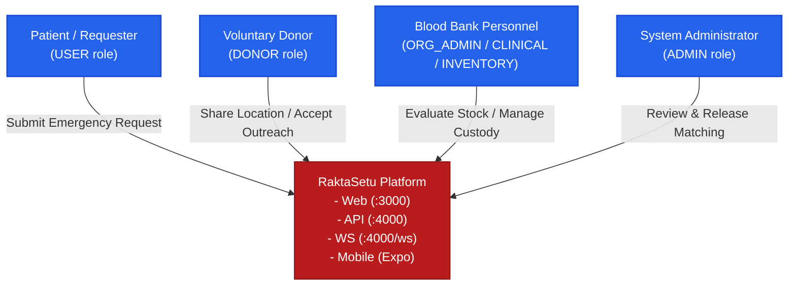

# RaktaSetu — System Overview & Architecture Context

## 1. System Vision & Context

**RaktaSetu** ("Bridge of Blood") is an enterprise-grade digital health logistics platform designed to coordinate emergency blood demand, blood bank component inventory, and voluntary donor networks across India.

### Core Problems Addressed
1. **Critical Fragmentation of Blood Stock:** In emergencies, patient relatives struggle frantically across disparate blood banks and fragmented web directories to locate compatible blood units.
2. **Uncontrolled Direct Donor Contact:** Unregulated public broadcasting of donor phone numbers leads to donor harassment, privacy violations, and panic outreach.
3. **Inventory-Bypassing Disconnect:** Many legacy systems trigger donor recruitment before checking whether certified, released blood units already sit in nearby blood bank freezers.
4. **Clinical Safety & Cold-Chain Violations:** Lack of end-to-end traceability between donor screening, phlebotomy, TTI laboratory testing, component derivation, and cold-chain handover risks transfusion-transmitted infections and compromised viability.

---

## 2. Core Architectural Principles (Source of Truth)

The as-built codebase strictly enforces the following non-negotiable architectural axioms:

1. **Inventory First, Matching Second:** A blood bank is permitted to request voluntary donor matching **only for the remaining shortfall** after all eligible, released in-house inventory units have been reserved and allocated.
2. **Deterministic Admin-Controlled Matching:** Patients and Blood Banks are strictly prohibited from executing arbitrary donor searches or modifying ranking algorithms. Only **System Administrators** review matching requests, execute the auditable deterministic matching algorithm, review ranked candidates, and explicitly release candidate lists.
3. **Strict Privacy & Targeted Visibility:**
   - Patients **never** see candidate lists, donor counts, or donor contact details.
   - Other Blood Banks **never** see candidates released to a peer Blood Bank.
   - Only the **requesting Blood Bank** receives the released candidate pool.
   - Donor phone numbers and exact live GPS coordinates are masked by default (`disclosureAuthorized: false`) until explicit consent and outreach events are recorded.
4. **Hard Clinical Eligibility Gates:** Geographic proximity never overrides clinical safety. Donors must satisfy the mandatory 90-day donation interval, active health profile status, and ABO/Rh compatibility rules before entering ranking tiers.
5. **Decoupled External Aggregation:** External availability data scraped or synchronized from the national e-RaktKosh portal is treated as transient availability snapshots (`BloodAvailabilitySnapshot`) and clearly demarcated from certified in-house bank inventory (`ComponentUnit`).
6. **Immutable Dual-Party Custody:** Blood bags and derived components require verified barcodes, temperature logs, and dual-party confirmation (sending blood bank dispatch + receiving hospital clinical intake + patient bed acknowledgment).

---

## 3. System Actors & Operational Roles

| Actor | Platform Role | Context / Scope | Key Responsibilities |
|---|---|---|---|
| **Patient / Family Requester** | `Role.USER` | Personal | Searches directory, submits emergency blood requests with hospital admission details, tracks stage progression in real-time, confirms final bedside receipt. |
| **Voluntary Blood Donor** | `Role.DONOR` | Personal | Registers health profile, toggles foreground/background GPS tracking, receives emergency outreach invitations, coordinates arrival at blood bank. |
| **Blood Bank Admin (`ORG_ADMIN`)** | `OrgRole.ORG_ADMIN` | Organisation | Manages blood bank profile, assigns staff roles, oversees camp readiness, requests donor matching for inventory shortfalls, creates issue orders. |
| **Clinical Staff (Medical Officer)** | `OrgRole.CLINICAL_STAFF` | Organisation | Performs donor screening, records deferrals, verifies TTI laboratory results, and executes authorized clinical release into available inventory. |
| **Inventory & Lab Staff** | `OrgRole.INVENTORY_STAFF` | Organisation | Derives blood components (PRBC, FFP, Platelets), manages cold storage locations, enters lab test results, prepares dispatch manifests. |
| **Collection Staff (Phlebotomist)** | `OrgRole.COLLECTION_STAFF` | Organisation / Camp | Verifies camp readiness, checks in attending donors, performs phlebotomy, labels blood collection bags, initiates handover manifests. |
| **Camp Coordinator** | `OrgRole.COLLECTION_STAFF` or External | Camp | Submits blood donation camp proposals, coordinates venue setup, and monitors real-time collection metrics. |
| **Platform System Admin** | `Role.ADMIN` | System-wide | Reviews blood centre registration applications, monitors statewide blood requests, runs deterministic matching algorithms, and explicitly releases candidate pools. |

---

## 4. External Integrations Ecosystem

The RaktaSetu platform integrates with three external systems:

1. **e-RaktKosh National Portal (`eraktkosh.ts`):**
   - **Endpoint:** `https://eraktkosh.mohfw.gov.in/eraktkoshPortal/eraktkosh`
   - **Role:** Fetches certified blood centres across districts (Maharashtra State Code 27) and retrieves live component availability snapshots.
   - **Resilience:** Implements retry logic, in-memory caching (`bloodCentresMap`), and graceful fallback when external government APIs encounter high latency or downtime.
2. **Meta WhatsApp Cloud API (`whatsapp.ts`):**
   - **Endpoint:** `https://graph.facebook.com/v18.0/{phone_number_id}/messages`
   - **Role:** Dispatches one-time verification passwords (OTP), emergency matching invitation alerts, and camp registration confirmations.
   - **Fallback:** In development environments (`NODE_ENV !== 'production'`), fixed demo OTPs (`123456`) are permitted via `ALLOW_DEMO_OTP=true`. Hardened runtime guards refuse to start production servers if demo OTP mode is detected.
3. **Mapbox GL & Geocoding API (`MapboxBloodMap.tsx`):**
   - **Endpoint:** `https://api.mapbox.com`
   - **Role:** Powers interactive GIS visualization of blood centres, distance estimation, and real-time live donor fleet mapping on blood bank and administrative consoles.

