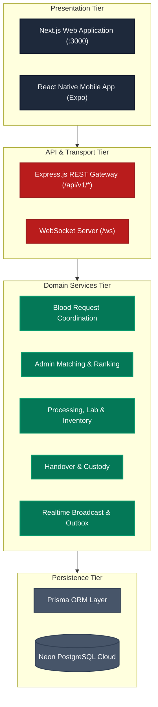

# RaktaSetu — High-Level Design (HLD)

## 1. Architectural Style & Multi-Tier Topology

RaktaSetu is designed around a **Clean, Modular Monolithic Tiered Architecture** paired with an **Event-Driven Asynchronous Broker**. This combines the operational simplicity of a single deployable backend with strict domain modularity, transactional consistency, and sub-second reactive updates.

---

## 2. Logical Subsystems & Responsibilities

The system is logically partitioned into six cohesive functional subsystems:

### Subsystem 1: Identity, Authentication & RBAC
- **Files:** `apps/api/src/services/auth.ts`, `apps/api/src/middleware/rbac.ts`, `apps/api/src/middleware/auth.ts`
- **Scope:** Issues cryptographically signed JSON Web Tokens (JWT), verifies E.164 phone numbers via OTP, resolves user memberships across blood centres, and evaluates granular organization permissions (e.g., `inventory:view`, `clinical:release`, `handover:dispatch`).

### Subsystem 2: Blood Request & Canonical Designation
- **Files:** `apps/api/src/services/bloodRequestCoordination.ts`, `apps/api/src/services/patientRequestCoordination.ts`
- **Scope:** Accepts patient emergency blood requests, maps recipient hospitals to canonical blood centres, registers requests under `BloodRequest`, and routes payloads directly to the designated Blood Bank's incoming queue.

### Subsystem 3: Inventory Allocation & Shortfall Evaluation
- **Files:** `apps/api/src/services/hospitalIntegration.ts`, `apps/api/src/services/processingAndInventory.ts`
- **Scope:** Evaluates eligible in-house released inventory against requested blood group and component. Automatically reserves matching units (`ComponentUnitStatus.RESERVED`), increments `allocatedUnits`, and calculates the exact remaining shortfall (`units - allocatedUnits`).

### Subsystem 4: Platform Admin Donor Matching & Release
- **Files:** `apps/api/src/services/adminMatchingService.ts`, `apps/api/src/routes/adminMatching.ts`
- **Scope:** Manages the administrative matching queue. Executes deterministic multi-tier ranking algorithms against certified voluntary donors. Enforces hard eligibility gates (90-day donation interval, active status), provides reason codes, and gates candidate delivery behind explicit System Admin approval.

### Subsystem 5: Clinical Intake, Phlebotomy & Testing
- **Files:** `apps/api/src/services/campOperations.ts`, `apps/api/src/services/traceability.ts`
- **Scope:** Manages donor arrival check-in, clinical health assessment, deferral logging, blood collection (`CollectionUnit`), mandatory TTI laboratory screening (HIV, Hepatitis B/C, Syphilis, Malaria), and Medical Officer clinical release sign-off.

### Subsystem 6: Handover, Custody & Receipt Confirmation
- **Files:** `apps/api/src/services/handover.ts`, `apps/api/src/services/pdfService.ts`
- **Scope:** Creates multi-unit transport manifests (`HandoverManifest`), enforces cold-chain temperature verification, reconciles receipt discrepancies, generates PDF documentation, and captures dual-party receipt confirmation (hospital receiving clinician and patient bedside acknowledgment).

---

## 3. Data Flow Architecture

### Level 0: System Boundary (Context DFD)
Refer to the native diagram at [`diagrams/dfd-level-0.mmd`](./diagrams/dfd-level-0.mmd). The Level 0 diagram visualizes the macroscopic boundaries of RaktaSetu:
- **Inbound Data:** Patient emergency requirements, donor health profiles and GPS pings, blood bank inventory records and dispatch manifests, admin matching approvals, and external e-RaktKosh stock snapshots.
- **Outbound Data:** Realtime request progression indicators, targeted donor outreach invitations, handover manifest PDFs, and bedside receipt acknowledgments.

### Level 1: Subsystems & Persistent Data Stores
Refer to the native diagram at [`diagrams/dfd-level-1.mmd`](./diagrams/dfd-level-1.mmd). Data flows interact through six core persistent datastores:
1. `D1: Users & Auth` (`users`, `sessions`, `organisation_memberships`)
2. `D2: Blood Requests & Routing` (`blood_requests`, `donor_responses`)
3. `D3: Donors & Location Sessions` (`donor_profiles`, `donor_location_sessions`, `donor_latest_locations`)
4. `D4: Inventory & Components` (`collection_units`, `component_units`, `storage_locations`)
5. `D5: Handover & Issue Orders` (`handover_manifests`, `hospital_issue_orders`)
6. `D6: Audit & Outbox Logs` (`audit_logs`, `outbox_events`)

