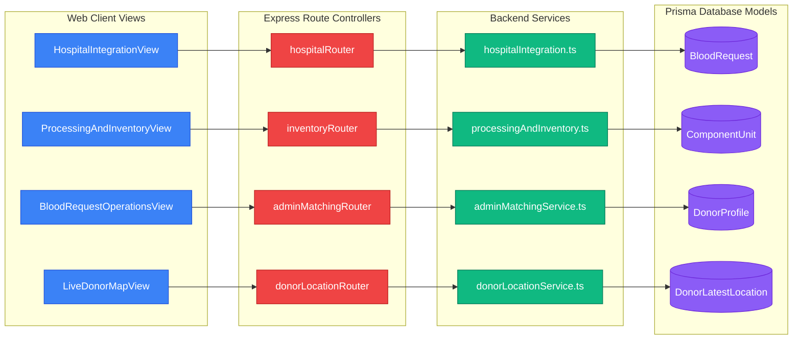

# RaktaSetu — Component Architecture & Internal Mapping

## 1. Architectural Component Map

---

## 2. Frontend Component Catalog (`apps/web/app/`)

### 1. `HospitalIntegrationView.tsx`
- **Location:** [`apps/web/app/organisation/portal/HospitalIntegrationView.tsx`](file:///d:/MyProject/RaktSetu/apps/web/app/organisation/portal/HospitalIntegrationView.tsx)
- **Responsibility:** The primary operational dashboard for Blood Bank personnel. Manages incoming designated patient requests, displays allocated stock vs. requested units, calculates remaining shortfall, provides the "Request Donor Matching" trigger, monitors matching statuses (`REQUESTED`, `SEARCH_RUNNING`, `CANDIDATES_FOUND`, `RELEASED`), and renders the Candidate Outreach Modal.
- **Key Hooks & State:** `useRealtime`, `authFetch`, `incomingRequests`, `isMatchingModalOpen`, `candidatePool`.
- **Status:** `[IMPLEMENTED & VERIFIED]`

### 2. `ProcessingAndInventoryView.tsx`
- **Location:** [`apps/web/app/organisation/portal/ProcessingAndInventoryView.tsx`](file:///d:/MyProject/RaktSetu/apps/web/app/organisation/portal/ProcessingAndInventoryView.tsx)
- **Responsibility:** Manages the component lab and cold-chain inventory. Supports component derivation (PRBC, FFP, Platelets from Whole Blood), TTI lab testing entry, Medical Officer clinical release sign-off, storage bin assignment, and quarantine hold management.
- **Key Sub-Views:** Derivation Table, Lab Testing Queue, Storage Grid, Inventory Category Summary.
- **Status:** `[IMPLEMENTED & VERIFIED]`

### 3. `BloodRequestOperationsView.tsx`
- **Location:** [`apps/web/app/organisation/portal/BloodRequestOperationsView.tsx`](file:///d:/MyProject/RaktSetu/apps/web/app/organisation/portal/BloodRequestOperationsView.tsx)
- **Responsibility:** Platform System Admin matching control console. Visualizes pending matching requests statewide, allows running deterministic donor matching algorithms, displays scored candidate rankings with explanation codes, and provides explicit checkbox candidate release triggers.
- **Status:** `[IMPLEMENTED & VERIFIED]`

### 4. `LiveDonorMapView.tsx`
- **Location:** [`apps/web/app/organisation/portal/LiveDonorMapView.tsx`](file:///d:/MyProject/RaktSetu/apps/web/app/organisation/portal/LiveDonorMapView.tsx)
- **Responsibility:** Mapbox GL-powered geospatial console for authorized blood banks to view nearby voluntary donors actively broadcasting GPS location sessions with active consent.
- **Status:** `[IMPLEMENTED & VERIFIED]`

---

## 3. API Route Controllers (`apps/api/src/routes/`)

| Route Controller | File Path | Base Path | Core Responsibilities | Middleware Mounted |
|---|---|---|---|---|
| `adminMatchingRouter` | `routes/adminMatching.ts` | `/api/v1/admin/donor-matching` | Matching queue queries, algorithm execution, candidate release | `requireAuth`, `requireRole('ADMIN')` |
| `hospitalRouter` | `routes/hospital.ts` | `/api/v1/organisation` | Incoming requests, matching triggers, released candidate retrieval, outreach | `requireAuth`, `requireOrgPermission` |
| `inventoryRouter` | `routes/inventory.ts` | `/api/v1/organisations/:id/inventory` | Inventory category summaries, component derivation, storage movements | `requireAuth`, `requireOrgPermission` |
| `traceabilityRouter` | `routes/traceability.ts` | `/api/v1/traceability` | End-to-end unit lineage tracing, lab record entry, clinical release | `requireAuth`, `requireOrgPermission` |
| `donorLocationRouter` | `routes/donorLocation.ts` | `/api/v1/donor-location` | Starting/stopping location sessions, ingesting mobile GPS coordinates | `requireAuth` |
| `requestsRouter` | `routes/requests.ts` | `/api/v1/blood-requests` | Canonical blood request submission, patient tracking, cancellation | `requireAuth` |
| `authRouter` | `routes/auth.ts` | `/api/v1/auth` | User OTP login (`demo-login`), token verification, session logout | Public / `requireAuth` for `/me` |
| `organisationsRouter` | `routes/organisations.ts`| `/api/v1/organisations` | Staff memberships, blood bank applications, camp management | `requireAuth`, `requireOrgPermission` |

---

## 4. Backend Domain Services (`apps/api/src/services/`)

### 1. `adminMatchingService.ts`
- **Responsibility:** Encapsulates the deterministic donor matching algorithm, hard eligibility filters (90-day interval, compatible ABO/Rh, active status), multi-tier scoring (Level 1 Centre, Level 2 District, Level 3 Expanded), System Admin release approval, and requesting bank candidate delivery.
- **Dependencies:** `prisma.bloodRequest`, `prisma.donorProfile`, `prisma.auditLog`, `RealtimeService`.

### 2. `hospitalIntegration.ts`
- **Responsibility:** Handles blood bank incoming request queries (matching canonical `assignedBankId` and external `hospitalCode`), reserves inventory against shortfall, triggers matching requests, and handles donor outreach records.
- **Dependencies:** `prisma.bloodRequest`, `prisma.componentUnit`, `prisma.hospitalIssueOrder`, `RealtimeService`.

### 3. `processingAndInventory.ts`
- **Responsibility:** Enforces component derivation rules (e.g. shelf-life expiration: PRBC 42d, Platelets 5d, FFP 365d), executes state transitions on `ComponentUnit`, and maintains storage location inventories.
- **Dependencies:** `prisma.collectionUnit`, `prisma.componentUnit`, `prisma.storageLocation`, `RealtimeService`.

### 4. `traceability.ts`
- **Responsibility:** Constructs comprehensive audit lineage trees (`TraceabilityLineageDTO`) connecting the original blood request, matching request, donor intake, screening, collection unit, lab tests, clinical release, and handover issue order.
- **Dependencies:** `prisma.bloodRequest`, `prisma.clinicalScreening`, `prisma.laboratoryTestRecord`, `prisma.clinicalReleaseRecord`.

### 5. `realtime.ts`
- **Responsibility:** High-performance WebSocket broker managing authorized client subscriptions to rooms (`org:{id}`, `user:{id}`, `admin:requests`), heartbeat ping/pong, and reliable event broadcasting.

