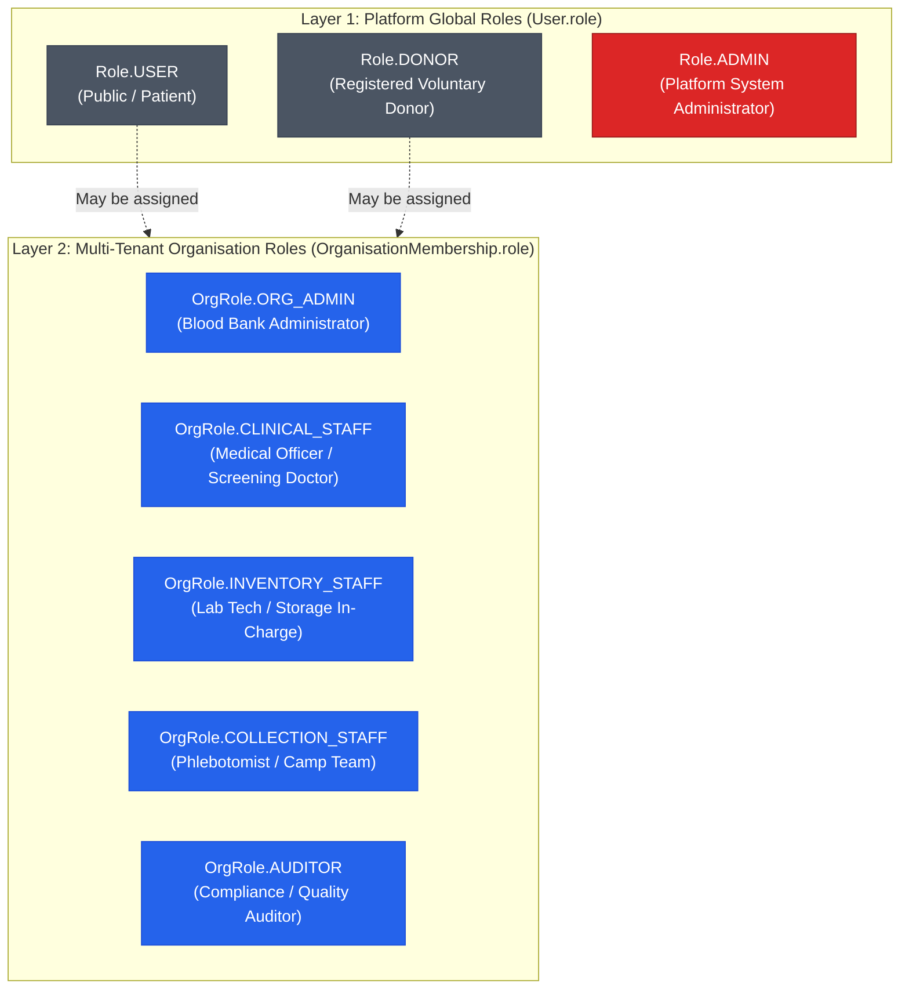

# RaktaSetu — User Roles, RBAC Architecture & Access Control Matrix

## 1. Role Architecture & Separation of Concerns

RaktaSetu implements a **Dual-Layered Role-Based Access Control (RBAC)** architecture that strictly segregates **Platform-Level Roles** from **Organisation-Level Roles**.

---

## 2. Platform Roles (`prisma/schema.prisma: enum Role`)

1. **`Role.USER`:**
   - **Assignment:** Assigned automatically upon initial phone number OTP verification.
   - **Scope:** Patient and family requester actions. Can create emergency requests, search public blood availability directories, and view personal request status.
2. **`Role.DONOR`:**
   - **Assignment:** Automatically elevated when a `User` completes voluntary donor registration (`POST /api/v1/donor-registration/submit`).
   - **Scope:** Includes all `USER` permissions plus managing donor availability, starting/stopping live GPS location sharing, responding to emergency matching invitations, and downloading donation certificates.
3. **`Role.ADMIN`:**
   - **Assignment:** Restricted to system-level administrators.
   - **Scope:** Statewide visibility. Approves blood centre registration applications, views global audit logs, executes the deterministic donor matching algorithm, and authorizes candidate list releases.

---

## 3. Organisation Roles (`prisma/schema.prisma: enum OrgRole`)

A user may belong to one or more blood centres via `OrganisationMembership`:

| Organisation Role | Primary Clinical / Operational Responsibility | Can Release Stock? | Can Screen Donors? | Can Run Matching? |
|---|---|---|---|---|
| **`ORG_ADMIN`** | Overall administration, staff role assignments, camp approval, inventory oversight, matching request initiation. | No (Clinical only) | Yes (Supervisory) | No (Admin only) |
| **`CLINICAL_STAFF`** | Medical Officer. Enforces clinical criteria, evaluates screening deferrals, signs off TTI lab verification and clinical inventory release. | **Yes (Authorized)**| **Yes (Sole Clinical)** | No |
| **`INVENTORY_STAFF`** | Component separation (PRBC/FFP), cold storage location management, temperature excursion checks, issue order dispatch. | No | No | No |
| **`COLLECTION_STAFF`** | Phlebotomy, blood bag barcoding, donor intake check-in at camps and blood centres, handover manifest creation. | No | No | No |
| **`AUDITOR`** | Read-only compliance inspection across manifests, custody records, and discrepancy logs. | No | No | No |

---

## 4. Master RBAC Permissions Matrix

As defined in [`packages/shared/src/index.ts`](file:///d:/MyProject/RaktSetu/packages/shared/src/index.ts#L118-L233):

| Granular Permission Code | Permission Description | `ORG_ADMIN` | `INVENTORY_STAFF` | `CLINICAL_STAFF` | `COLLECTION_STAFF` | `AUDITOR` |
|---|---|:---:|:---:|:---:|:---:|:---:|
| `org:view` | View organisation profile & basic details | ✅ | ✅ | ✅ | ✅ | ✅ |
| `staff:list` | View registered staff members & roles | ✅ | ✅ | ✅ | ❌ | ✅ |
| `staff:invite` | Invite or add new staff members | ✅ | ❌ | ❌ | ❌ | ❌ |
| `staff:update_role` | Change staff permissions or deactivate staff | ✅ | ❌ | ❌ | ❌ | ❌ |
| `camp:manage` | Create, edit, and approve donation camps | ✅ | ❌ | ❌ | ✅ | ❌ |
| `camp:attendance` | Check-in donors and record attendance | ✅ | ✅ | ✅ | ✅ | ❌ |
| `clinical:screen` | Record clinical screening & deferral decisions| ✅ | ❌ | ✅ | ❌ | ❌ |
| `donation:record` | Record phlebotomy bleed, bag barcode & volume | ✅ | ❌ | ✅ | ✅ | ❌ |
| `collection:manage` | Manage collection batches & bags | ✅ | ❌ | ❌ | ✅ | ❌ |
| `component:derive` | Derive PRBC, FFP, Platelets from Whole Blood | ✅ | ✅ | ✅ | ❌ | ❌ |
| `unit:view` | View collection & component unit details | ✅ | ✅ | ✅ | ✅ | ✅ |
| `unit:transition` | Update unit status (e.g. Quarantined) | ✅ | ✅ | ❌ | ✅ | ❌ |
| `handover:create` | Create handover / transport manifest | ✅ | ❌ | ❌ | ✅ | ❌ |
| `handover:dispatch` | Dispatch manifest with transport details | ✅ | ❌ | ❌ | ✅ | ❌ |
| `handover:receive` | Receive & inspect blood bags at centre | ✅ | ✅ | ❌ | ❌ | ❌ |
| `handover:reconcile` | Reconcile discrepancies & cold-chain leaks | ✅ | ✅ | ❌ | ❌ | ❌ |
| `handover:view` | Inspect manifest history & status | ✅ | ✅ | ✅ | ✅ | ✅ |
| `lab:record` | Enter TTI test results & blood grouping | ✅ | ✅ | ✅ | ❌ | ❌ |
| `lab:verify` | Medically verify and sign off lab results | ❌ | ❌ | ✅ | ❌ | ❌ |
| `clinical:release` | **Authorize release into available stock** | ❌ | ❌ | ✅ | ❌ | ❌ |
| `storage:manage` | Assign shelves/refrigerators, move units | ✅ | ✅ | ✅ | ❌ | ❌ |
| `inventory:view` | View live released and reserved stock | ✅ | ✅ | ✅ | ❌ | ✅ |
| `disposition:record` | Authorize discard of reactive/expired blood | ✅ | ✅ | ✅ | ❌ | ❌ |
| `audit:read` | Read immutable compliance logs | ✅ | ❌ | ❌ | ❌ | ✅ |
| `operational:read` | Read general operational metrics | ✅ | ✅ | ✅ | ✅ | ✅ |
| `operational:write` | Write general operational entries | ✅ | ✅ | ✅ | ✅ | ❌ |

---

## 5. Security & Clinical Safety Enforcement

1. **Enforcement in Backend Middleware:**
   - Every protected route invokes `requireAuth` followed by `requireOrgPermission(permission)` ([`apps/api/src/middleware/rbac.ts`](file:///d:/MyProject/RaktSetu/apps/api/src/middleware/rbac.ts)).
   - Even if a client bypasses UI guards, the backend strictly rejects requests with `403 Forbidden: Insufficient permissions for organisation` if the user's role lacks the permission code.
2. **Clinical Safety Boundary (`clinical:release`):**
   - Notice that `ORG_ADMIN` **cannot** clinically release blood. Even the blood bank administrator is denied clinical release authority unless they hold the `CLINICAL_STAFF` credential. This guarantees that non-clinical administrators cannot override medical safety protocols.

