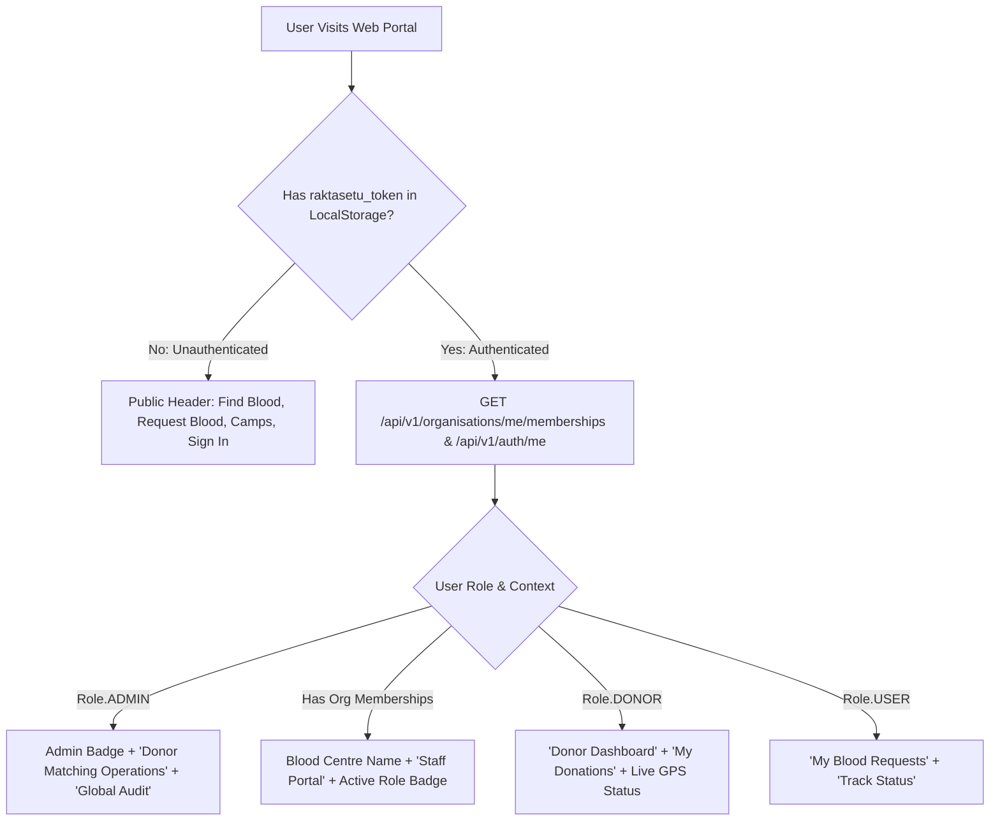

# RaktaSetu — Portal & Navigation Inventory

## 1. Master Web Navigation Map

The web application ([`@raktasetu/web`](file:///d:/MyProject/RaktSetu/apps/web)) utilizes Next.js App Router conventions with client-side reactive navigation guards:

| Route Path | Page Purpose | Roles Permitted | Key Components Loaded | Primary APIs Called | Next Navigation Targets |
|---|---|---|---|---|---|
| `/` | Public Home Landing Page | Public / All | `page.tsx`, `Header.tsx`, `Footer.tsx` | None (Static) | `/find-blood`, `/requests/new`, `/login` |
| `/find-blood` | Blood Availability Directory | Public / All | `page.tsx`, `MapboxBloodMap.tsx` | `GET /api/v1/blood-availability` | `/requests/new?bankId=...`, `/blood-centres/[id]` |
| `/directory` | National Blood Centres List | Public / All | `page.tsx`, `Header.tsx` | `GET /api/v1/blood-centres` | `/blood-centres/[id]` |
| `/requests/new` | Emergency Blood Request Form | `USER`, `DONOR`, `ADMIN` | `page.tsx`, Hospital selector | `POST /api/v1/blood-requests` | `/requests/[id]` (Tracking page) |
| `/requests` | Patient Blood Requests List | `USER`, `DONOR` | `page.tsx` | `GET /api/v1/blood-requests` | `/requests/[id]` |
| `/requests/[id]` | Realtime Request Status | `USER`, `DONOR`, `ADMIN` | `page.tsx`, `StatusBadge.tsx` | `GET /api/v1/blood-requests/:id` | `/requests` |
| `/donor-dashboard` | Voluntary Donor Portal | `DONOR`, `ADMIN` | `page.tsx`, `useRealtime` | `GET /api/v1/donors/me`, `GET /api/v1/donor-location/my-session` | `/profile`, `/camps` |
| `/donor-registration` | Multi-Step Donor Onboarding | `USER`, `DONOR` | `page.tsx`, Health questionnaire | `POST /api/v1/donor-registration/submit` | `/donor-dashboard` |
| `/organisation/portal` | Master Blood Bank Portal | `ORG_ADMIN`, `CLINICAL`, `INVENTORY`, `COLLECTION`, `AUDITOR` | `page.tsx`, `HospitalIntegrationView`, `ProcessingAndInventoryView` | `GET /api/v1/organisations/me/memberships`, `GET /api/v1/organisation/:id/incoming-requests` | Tab switches: `overview`, `requests`, `inventory`, `lab`, `handover`, `staff` |
| `/camp/dashboard` | Camp Operations Workspace | `COLLECTION_STAFF`, `ORG_ADMIN` | `page.tsx`, Phlebotomy form | `GET /api/v1/organisations/:id/camps` | `/camp/donor-registration` |
| `/login` | Unified OTP Authentication | Public / All | `page.tsx`, OTP modal | `POST /api/v1/auth/demo-login` | Auto-redirects based on role memberships |
| `/organisation/register-bank` | New Centre Registration | Public / Requester | `page.tsx`, License upload | `POST /api/v1/organisations/applications` | `/login` (Pending review message) |

---

## 2. Header & Role-Based Action Redirection

The global application header ([`apps/web/app/components/Header.tsx`](file:///d:/MyProject/RaktSetu/apps/web/app/components/Header.tsx)) dynamically evaluates the authenticated user's session token and memberships:

---

## 3. Blood Bank Portal Tabbed Architecture (`/organisation/portal`)

The Master Blood Bank Portal ([`apps/web/app/organisation/portal/page.tsx`](file:///d:/MyProject/RaktSetu/apps/web/app/organisation/portal/page.tsx)) organizes operations into 13 dedicated functional workspaces:

1. **`overview`:** Executive metrics (Total in-transit bags, quarantined units, available units, pending patient requests).
2. **`requests` (`HospitalIntegrationView.tsx`):** Incoming designated patient blood requests, shortfall calculator, matching request button, and candidate outreach modal.
3. **`inventory` (`ProcessingAndInventoryView.tsx`):** Component units grouped by blood group and component type, expiration monitoring, and cold storage bin assignments.
4. **`lab` (`ProcessingAndInventoryView.tsx`):** Mandatory TTI testing queue (HIV, HBsAg, HCV, Syphilis, Malaria) and clinical release sign-off.
5. **`handover`:** Handover manifest generator, dispatch manifest table, cold-chain temperature verification, and receipt reconciliation.
6. **`camps`:** Camp readiness verification checklist (staff, cold chain, consumables) and collection batch tracking.
7. **`proposals`:** Review and approval of community camp proposals.
8. **`donor-map` (`LiveDonorMapView.tsx`):** Realtime Mapbox GL map rendering nearby active voluntary donors.
9. **`staff`:** Blood bank personnel roster, role modifications (`ORG_ADMIN` to `CLINICAL_STAFF`), and staff invitations.
10. **`settings`:** Centre license information, address, operating hours, and hospital linkage codes.
11. **`reports`:** Automated regulatory reports and donation statistics.
12. **`applications`:** State blood centre onboarding application review queue (for System Admin).
13. **`admin-requests` (`BloodRequestOperationsView.tsx`):** System Admin donor matching operations console (rendered when logged-in user holds `Role.ADMIN`).

---

## 4. Mobile Screen Flow (`apps/mobile/App.tsx`)

In the React Native mobile application:
- **Unauthenticated Flow:**
  - `PUBLIC_HOME` (Blood directory highlights, emergency banner)
  - `FIND_BLOOD` (Centre search by district)
  - `NEARBY_DONORS` (Proximity search hint)
  - `BLOOD_REQUESTS` (Public view of active regional requirements)
  - `LOGIN` (Phone number & OTP screen)
- **Authenticated Bottom Tab Navigation:**
  - `HOME`: Donor home dashboard or Camp Operations workspace switcher.
  - `FIND_BLOOD`: Native map and directory search.
  - `DONOR_DASHBOARD`: Live location sharing toggle, health eligibility countdown, donation history.
  - `REQUESTS`: Emergency blood request creation and tracking.
  - `PROFILE`: User account details, notification preferences, logout.

