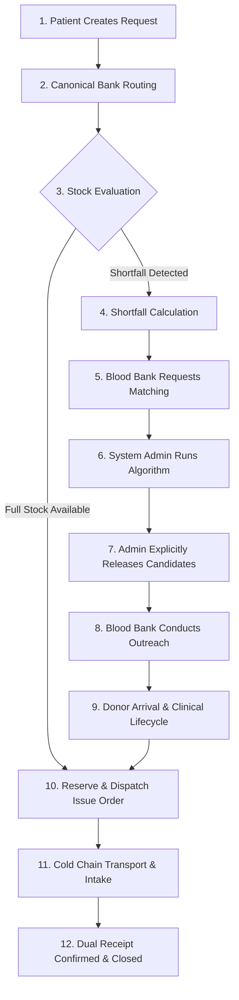

# RaktaSetu — Complete Blood Request Lifecycle & Workflow Architecture

## 1. End-to-End Workflow Overview

The RaktaSetu blood request lifecycle traces the complete journey from emergency patient need to confirmed bedside transfusion across 12 rigorous stages:

---

## 2. Comprehensive 12-Stage Lifecycle Specification

### Stage 1: Request Creation & Canonical Designation
- **Actor:** Patient or Hospital Attendant.
- **Action:** Submits emergency request at `/requests/new`. Selects patient name, blood group, component (e.g. PRBC), units requested, and explicitly designates a certified Blood Bank (`assignedBankId`).
- **Persistence:** Persisted in `BloodRequest` with `status: 'OPEN'`, `allocatedUnits: 0`.

### Stage 2: Routing to Designated Blood Bank
- **Mechanism:** The backend service writes routing metadata into `BloodRequest.message`.
- **Realtime Event:** `blood_request.created` is pushed directly to the designated Blood Bank's WebSocket channel (`org:{assignedBankId}`).
- **Blood Bank UI:** Instantly renders in the Blood Bank's "Incoming Requests" table without manual page refresh.

### Stage 3 & 4: Inventory Evaluation & Shortfall Calculation
- **Actor:** Blood Bank Inventory Staff.
- **System Logic:** Checks in-house released inventory (`ComponentUnit` where `status: 'AVAILABLE'`).
- **Shortfall Formula:**
  $$\text{Shortfall} = \max(0, \text{unitsRequested} - \text{allocatedUnits})$$
- **Outcome A (Stock Sufficient):** If shortfall is 0, the UI displays green badge `"Inventory Allocated (Stock Sufficient)"`. Matching trigger is disabled.
- **Outcome B (Shortfall > 0):** The UI activates the `"Request Donor Matching (Shortfall: N)"` button.

### Stage 5: Blood Bank Requests Donor Matching
- **Action:** Staff clicks "Request Donor Matching".
- **API Call:** `POST /api/v1/organisation/:orgId/requests/:requestId/request-matching`.
- **State Change:** Metadata updated: `matchingRequest: { status: 'REQUESTED', requestedShortfall: N }`.
- **Realtime Event:** Dispatches `blood_request.matching_requested` to System Admin.

### Stage 6: System Admin Matching Run & Deterministic Ranking
- **Actor:** Platform System Admin (Role `ADMIN`).
- **Action:** Reviews matching queue at `/organisation/portal` (Admin Requests tab) and clicks "Run Matching Algorithm".
- **Algorithm Execution:** Enforces hard clinical filters (90-day donation interval, active profile, ABO compatibility), scores proximity tiers, and generates deterministic rankings with explanation codes.
- **State Change:** `matchingRequest.status` transitions to `'CANDIDATES_FOUND'`.
- **Blood Bank UI:** Badges reactively update to `"Candidates Under Admin Review"`.

### Stage 7: Admin Explicit Review & Candidate Release
- **Actor:** Platform System Admin.
- **Action:** System Admin reviews candidates, verifies justification, selects candidates via checkboxes, and clicks "Release Approved Candidates".
- **State Change:** `matchingRequest.status` transitions to `'RELEASED'`.
- **Audit:** Immutable entry written to `AuditLog` (`ADMIN_CANDIDATE_RELEASE`).
- **Realtime Event:** Dispatches `blood_request.matching_released` to requesting bank.

### Stage 8: Requesting Blood Bank Outreach
- **Actor:** Blood Bank Staff.
- **Action:** Clicks newly unlocked "Review Released Candidate Pool" button.
- **Privacy Gating:** System returns masked candidate profiles (`disclosureAuthorized: false`). Staff clicks "Send Outreach" or logs phone response (`ACCEPTED` or `DECLINED`).

### Stage 9: Clinical Lifecycle (Intake $\rightarrow$ Bleed $\rightarrow$ Testing $\rightarrow$ Release)
- **Donor Arrival:** Staff records donor arrival at `/camp/dashboard` or blood centre intake.
- **Clinical Assessment:** Medical Officer conducts physical examination (Hb $\ge 12.5\text{ g/dL}$, BP, weight $\ge 45\text{ kg}$) and logs clearance.
- **Collection:** Phlebotomist draws blood into barcoded collection bag (`CollectionUnit`).
- **TTI Testing:** Lab tech records HIV, HBsAg, HCV, Syphilis, and Malaria test results.
- **Clinical Release:** Medical Officer verifies all tests are non-reactive and signs off clinical release into `ComponentUnit` (`AVAILABLE`).

### Stage 10: Allocation & Hospital Issue Order Generation
- **Action:** The newly released component is reserved against the pending blood request, bringing `shortfallCount` to 0. Staff generates `HospitalIssueOrder`.

### Stage 11: Cold-Chain Handover & Dispatch
- **Action:** Units are placed in cold-chain transport boxes ($2^\circ\text{C} - 6^\circ\text{C}$). Handover manifest PDF is exported and dispatched.

### Stage 12: Dual Receipt Confirmation & Request Closure
- **Dual Confirmation:**
  1. Hospital intake nurse signs physical/digital receipt (`hospitalReceivedAt`).
  2. Patient confirms receipt at `/requests/[id]` (`patientAcknowledgedAt`).
- **Final Transition:** `BloodRequest.status` transitions from `OPEN` to `CLOSED`.

