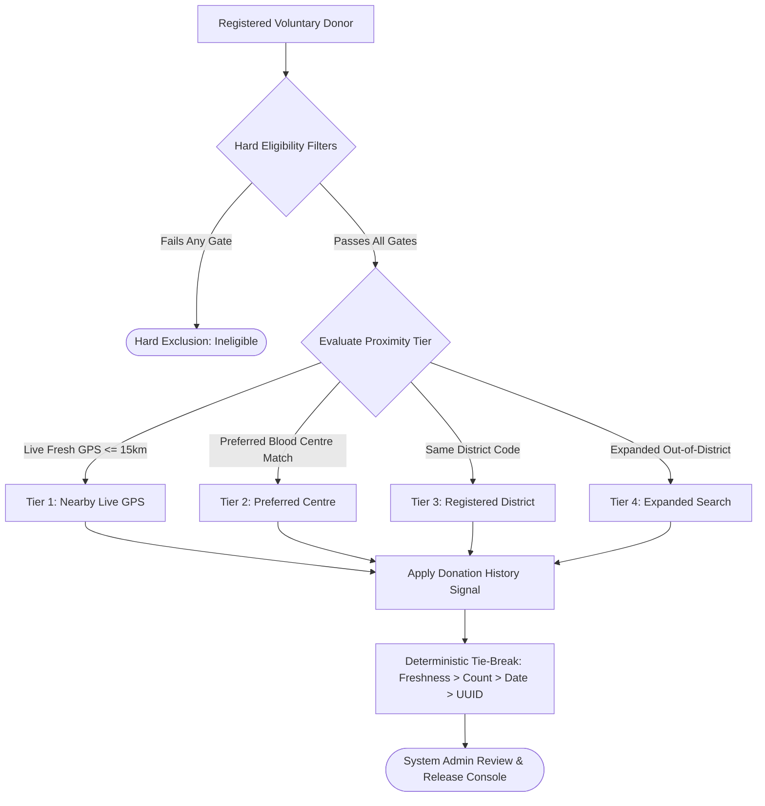
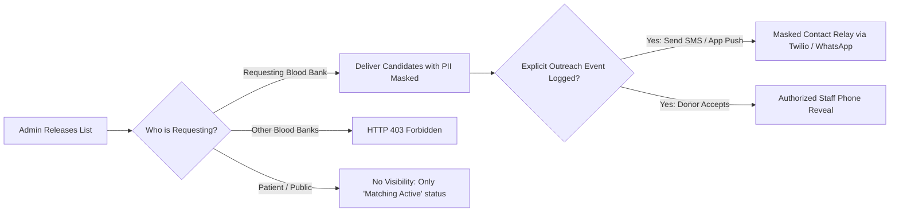

# RaktaSetu — Donor Matching Architecture & Data Flow

## 1. Matching System Context & Architecture

The RaktaSetu Donor Matching Engine ([`adminMatchingService.ts`](file:///d:/MyProject/RaktSetu/apps/api/src/services/adminMatchingService.ts)) operates under strict administrative supervision and deterministic rules:

---

## 2. Hard Eligibility Filters (Mandatory Exclusions)

A donor candidate must satisfy **every one** of the following hard clinical criteria. If a single criterion fails, the donor is completely excluded from the candidate pool:

| Hard Clinical Filter | Source Field / Model | Code Implementation | Medical Rationale |
|---|---|---|---|
| **Account Active** | `User.status == 'ACTIVE'` | `donor.user.status === 'ACTIVE'` | Suspended or deactivated users cannot donate. |
| **Voluntary Consent** | `DonorProfile.consentToContact` | `donor.consentToContact === true` | Privacy regulations forbid unconsented emergency outreach. |
| **Availability Active** | `DonorProfile.isAvailable` | `donor.isAvailable === true` | Respects donor's self-declared availability toggle. |
| **ABO/Rh Compatibility** | `DonorProfile.bloodGroup` | `compatibleGroups.includes(donor.bloodGroup)` | Prevents acute hemolytic transfusion reactions. |
| **90-Day Donation Interval** | `DonorProfile.lastDonationDate` | `daysSinceLastDonation >= 90` | Mandatory clinical cooldown for red blood cell recovery. |

---

## 3. ABO & Rh Compatibility Matrix

RaktaSetu implements standard immunohematological compatibility:

| Recipient Blood Group | Clinically Compatible Donor Blood Groups |
|---|---|
| **A+ (`A_POS`)** | `A+`, `A-`, `O+`, `O-` |
| **A- (`A_NEG`)** | `A-`, `O-` |
| **B+ (`B_POS`)** | `B+`, `B-`, `O+`, `O-` |
| **B- (`B_NEG`)** | `B-`, `O-` |
| **AB+ (`AB_POS`)** | Universal Recipient: `A+`, `A-`, `B+`, `B-`, `AB+`, `AB-`, `O+`, `O-` |
| **AB- (`AB_NEG`)** | `AB-`, `A-`, `B-`, `O-` |
| **O+ (`O_POS`)** | `O+`, `O-` |
| **O- (`O_NEG`)** | Universal Donor: `O-` only |

---

## 4. Deterministic Ranking & Scoring Rules

Eligible candidates are ranked deterministically without random weights:

### Tier 1: Proximity & Geographic Level
1. **Level 1 (Exact Centre / Proximity):**
   - **Fresh Live GPS (`FRESH_GPS`):** Donor broadcasted GPS location within the last 30 minutes and is located within 15 km of the blood bank. Score: `1000 - (distanceKm * 10)`.
   - **Preferred Centre Match:** Donor explicitly selected this blood centre as their primary donation facility. Score: `800`.
   - **Stale GPS (`STALE_GPS`):** Donor broadcasted GPS within 24 hours. Score: `600 - (distanceKm * 5)`.
2. **Level 2 (District Scope):**
   - **Registered District Match:** Donor's registered residence district matches the blood bank's district code (`districtCode === 521` for Pune). Score: `400`.
3. **Level 3 (Expanded Scope):**
   - **Out-of-District Eligible:** Donor registered in adjacent districts (requires System Admin scope expansion authorization). Score: `200`.

### Tier 2: Donation History Prioritization Signal
- **Regular Verified Donor:** Donor has completed $\ge 2$ successful donations without adverse events. Added score: `+50`.
- **Completed Donations Count:** Each completed donation adds `+10` points (capped at `+50`).

### Tier 3: Deterministic Tie-Breaker
When two candidates possess identical composite scores, ties are resolved deterministically in the following priority order:
1. Freshness of live location timestamp (most recent wins).
2. Total completed donations count (higher count wins).
3. Days since last donation (longer cooldown wins).
4. Lexicographical order of Donor UUID (guarantees 100% deterministic, reproducible sorting).

---

## 5. Candidate Privacy Boundaries & Access Gating

RaktaSetu implements strict confidentiality boundaries to protect voluntary donors from unsolicited harassment:

- **Candidate Names:** Displayed as generic `"Voluntary Donor"` on all list views.
- **Phone Numbers:** Masked (`contactNumber: null`) until explicit disclosure authorization is logged.
- **GPS Coordinates:** Exact latitude/longitude are never exposed to blood banks; only estimated distance bands (e.g. `1.3 km`) and locality names (e.g. `Shivajinagar, Pune`) are rendered.

