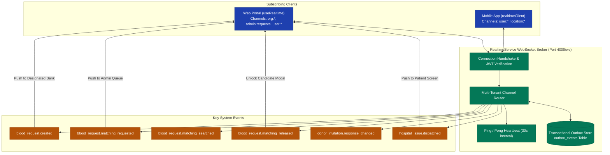

# RaktaSetu — Realtime & Event-Driven Architecture

## 1. Realtime Infrastructure & WebSocket Topology

RaktaSetu features a production-ready reactive event engine implemented in [`apps/api/src/services/realtime.ts`](file:///d:/MyProject/RaktSetu/apps/api/src/services/realtime.ts) and mounted on `ws://localhost:4000/ws`.



---

## 2. Channel & Room Authorization

WebSocket connections authenticate via a signed Bearer JWT passed in the initial message payload:
```json
{
  "type": "auth",
  "token": "eyJhbGciOi..."
}
```
Upon verification, `RealtimeService` evaluates the user's role and organisation memberships to determine permitted subscription channels:

| Channel Pattern | Authorization Rule | Permitted Events Dispatched |
|---|---|---|
| `admin:requests` | User has `Role.ADMIN` | `blood_request.matching_requested`, `blood_request.status_changed` |
| `org:{orgId}` | User is active member of `Organisation` | `blood_request.created`, `blood_request.matching_searched`, `blood_request.matching_released`, `inventory.summary_changed` |
| `user:{userId}` | `sub === userId` | `donor_invitation.response_changed`, `blood_request.allocated` |
| `location:{orgId}` | Member has `operational:read` permission | `donor_location.updated` (GPS pings) |

---

## 3. Realtime Event Envelope & Master Event Catalog

Every event transmitted through the WebSocket adheres to the standardized envelope ([`RealtimeEventEnvelope<T>`](file:///d:/MyProject/RaktSetu/packages/shared/src/index.ts#L896)):
```json
{
  "eventId": "evt_1792601446726_a1b2",
  "eventType": "blood_request.matching_released",
  "schemaVersion": "1.0",
  "timestamp": "2026-11-02T09:57:50.555Z",
  "organisationId": "a08a30e0-cb21-40b0-bf83-35a0670f684d",
  "recipientUserId": null,
  "entityType": "BloodRequest",
  "entityId": "3f0023c4-5ffd-4c1c-af51-a6df3d3aa264",
  "payload": {
    "status": "RELEASED",
    "releasedCount": 2,
    "requestId": "3f0023c4-5ffd-4c1c-af51-a6df3d3aa264"
  }
}
```

### Dispatched System Events
1. **`blood_request.created`:** Dispatched when a patient creates a request. Alerting the designated blood bank in real time.
2. **`blood_request.matching_requested`:** Dispatched when a blood bank requests donor matching for remaining shortfall. Alerts System Admin.
3. **`blood_request.matching_searched`:** Dispatched when System Admin executes the matching algorithm. Updates Blood Bank UI badge to "Candidates Under Admin Review".
4. **`blood_request.matching_released`:** Dispatched when System Admin authorizes release. Unlocks candidate modal in Blood Bank UI.
5. **`donor_invitation.response_changed`:** Dispatched when a donor accepts or declines outreach.
6. **`hospital_issue.dispatched`:** Dispatched when cold-chain handover is initiated. Alerts hospital and patient tracking views.
7. **`donor_location.updated`:** Realtime GPS updates streaming from active mobile donors to the live map.

---

## 4. Transactional Outbox Pattern & Reconnection Recovery

1. **Guaranteed Delivery:**
   When mission-critical events occur (e.g. matching release, issue dispatch), `RealtimeService.emitAndPersist()` writes the event envelope to the `outbox_events` table within the same database transaction.
2. **Client Replay on Reconnect:**
   If a client drops connection, the client sends a replay request upon reconnecting:
   ```json
   {
     "type": "replay",
     "sinceTimestamp": "2026-11-02T09:55:00.000Z"
   }
   ```
   The server queries `outbox_events` and streams any missed events in strict chronological order, guaranteeing zero lost state updates.

