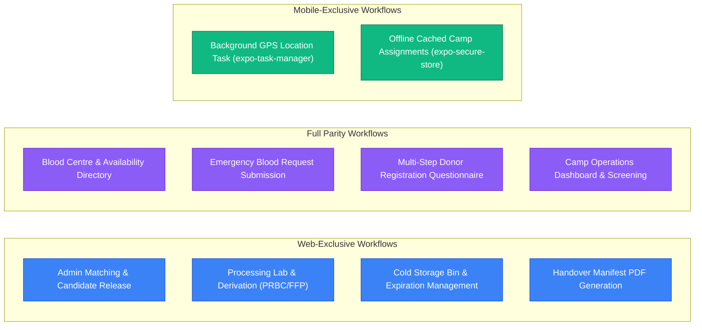

# RaktaSetu — Web and Mobile Architecture & Feature Parity

## 1. Architectural Distribution Across Platforms

RaktaSetu maintains cross-platform capabilities between the **Next.js 16 Web Application** (optimized for clinical, laboratory, administrative, and public browser workflows) and the **Expo React Native Mobile App** (optimized for voluntary donors and camp phlebotomy on the go).

---

## 2. Web vs. Mobile Feature Parity Matrix

| Operational Feature | Web Portal Implementation | Mobile App Implementation | Shared Contracts | Parity Status | Functional Differences |
|---|---|---|---|---|---|
| **Public Directory Search** | `apps/web/app/find-blood/page.tsx` | `apps/mobile/src/screens/FindBloodScreen.tsx` | `BloodCentre`, `BloodAvailabilitySnapshot` | `[PARITY COMPLETE]` | Web uses Mapbox GL vector tiles; Mobile uses native list and district filters. |
| **Emergency Request Form** | `apps/web/app/requests/new/page.tsx` | `apps/mobile/src/screens/BloodRequestsScreen.tsx` | `BloodRequestInput` | `[PARITY COMPLETE]` | Identical validation, component selection, and canonical routing. |
| **Request Tracking** | `apps/web/app/requests/[id]/page.tsx` | `apps/mobile/src/screens/BloodRequestsScreen.tsx` | `RequestStatus`, `StageTracking` | `[PARITY COMPLETE]` | Both receive real-time stage updates via WebSocket. |
| **Donor Registration** | `apps/web/app/donor-registration/page.tsx`| `apps/mobile/src/screens/DonorRegistrationScreen.tsx`| `DonorRegistrationInput` | `[PARITY COMPLETE]` | Identical multi-step health questionnaire and consent contracts. |
| **Live Location Sharing**| `apps/web/app/donor-dashboard/page.tsx` | `apps/mobile/src/services/locationTracking.ts` | `LocationSessionDTO`, `UpdateLocationInput`| `[MOBILE ADVANCED]`| Mobile supports background GPS updates via `expo-task-manager`. Web is foreground browser-only. |
| **Camp Intake & Screening**| `apps/web/app/camp/dashboard/page.tsx` | `apps/mobile/src/screens/CampOperationsDashboardScreen.tsx`| `CampAttendance`, `ClinicalScreening` | `[PARITY COMPLETE]` | Both allow phlebotomists to check in donors and record screening decisions. |
| **Admin Donor Matching** | `BloodRequestOperationsView.tsx` | Not Implemented on Mobile | `RankedDonorCandidateDTO` | `[WEB EXCLUSIVE]` | System Admin matching runs require wide-screen review console. |
| **Component Derivation** | `ProcessingAndInventoryView.tsx` | Not Implemented on Mobile | `DeriveComponentsInput` | `[WEB EXCLUSIVE]` | Lab component derivation is performed on desktop lab workstations. |
| **Handover Reconciliation**| `apps/web/app/organisation/portal` | Not Implemented on Mobile | `HandoverManifestDetail` | `[WEB EXCLUSIVE]` | Reconciling manifests and temperature breaches is web-exclusive. |

---

## 3. Mobile Hardware & Native Services

### 1. Background GPS Task (`apps/mobile/src/services/locationTask.ts`)
- Utilizes `expo-task-manager` and `expo-location` with `defineTask(BACKGROUND_LOCATION_TASK, ...)`.
- Automatically wakes in the background when the device moves significantly, reads location coordinates, and transmits them to `POST /api/v1/donor-location/update`.
- Strictly checks active session status and stops immediately if consent is revoked or session is marked `STOPPED`.

### 2. Secure Token Storage (`apps/mobile/src/services/authStorage.ts`)
- Utilizes `expo-secure-store` to encrypt JWT session tokens in hardware keystores (Android KeyStore / iOS Keychain).
- Caches staff camp assignments locally for offline readiness inspection while requiring online server verification before granting elevated access.

