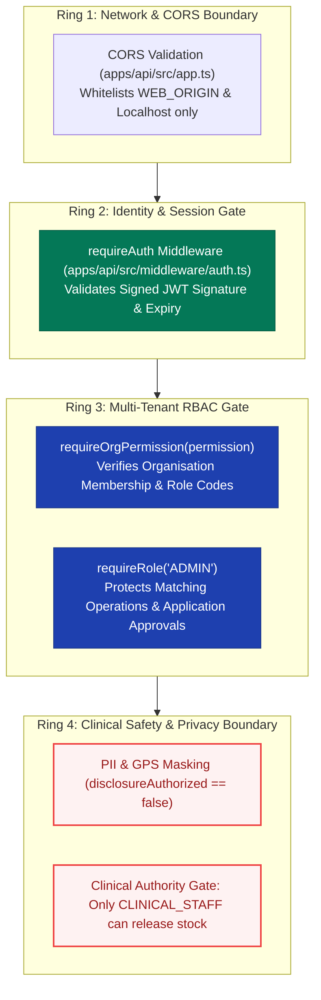

# RaktaSetu — Security, Privacy, Safety & Failure Architecture

## 1. Multi-Tier Security Boundary Topology

RaktaSetu implements four concentric defense-in-depth security rings:

---

## 2. Donor Privacy Protection & PII Masking

To prevent donor harassment, predatory commercial sourcing, and privacy leaks, RaktaSetu enforces strict masking at the database service layer ([`apps/api/src/services/adminMatchingService.ts`](file:///d:/MyProject/RaktSetu/apps/api/src/services/adminMatchingService.ts)):

1. **Default State for Released Candidates:**
   - When candidates are delivered to the requesting blood bank, `contactNumber` is explicitly stripped (`contactNumber: null`).
   - `displayName` is replaced with `"Voluntary Donor"`.
   - `disclosureAuthorized` is set to `false`.
2. **Geographic Masking:**
   - Exact GPS coordinates (`latitude`, `longitude`) are never transmitted in matching candidate payloads.
   - The UI receives only estimated distance (`distanceKm: 1.3`), locality description (`locality: "Shivajinagar, Pune"`), and proximity tier (`FRESH_GPS` / `STALE_GPS`).
3. **Outreach Gate:**
   - Blood banks cannot view raw phone numbers directly. They trigger system invitations through permitted communication channels (WhatsApp Cloud API / SMS gateway / App Push).
   - Only when a donor explicitly accepts an emergency matching invitation can the requesting blood bank access direct contact details to coordinate immediate arrival.

---

## 3. Clinical Safety Authority Boundaries

RaktaSetu establishes immutable clinical boundaries in software logic:

| Clinical / Operational Action | Permitted Role | Explicitly Forbidden Roles | Enforced Failure Behavior |
|---|---|---|---|
| **Donor Health Deferral** | `CLINICAL_STAFF`, `ORG_ADMIN` | `INVENTORY_STAFF`, `COLLECTION_STAFF` | HTTP 403 Forbidden (`clinical:screen` required) |
| **Phlebotomy Collection** | `COLLECTION_STAFF`, `CLINICAL_STAFF` | `AUDITOR`, `INVENTORY_STAFF` | HTTP 403 Forbidden (`donation:record` required) |
| **Component Derivation** | `INVENTORY_STAFF`, `CLINICAL_STAFF`, `ORG_ADMIN` | `COLLECTION_STAFF`, `AUDITOR` | HTTP 403 Forbidden (`component:derive` required) |
| **TTI Laboratory Result Entry**| `INVENTORY_STAFF`, `CLINICAL_STAFF`, `ORG_ADMIN` | `COLLECTION_STAFF`, `AUDITOR` | HTTP 403 Forbidden (`lab:record` required) |
| **Clinical Release Sign-Off** | **`CLINICAL_STAFF` Only** | **`ORG_ADMIN`**, `INVENTORY_STAFF`, `COLLECTION_STAFF` | **HTTP 403 Forbidden (`clinical:release` required)** |
| **Donor Matching Execution**| **`Role.ADMIN` Only** | **All Blood Bank Roles**, Patients | **HTTP 403 Forbidden (System Admin role required)** |

> [!IMPORTANT]
> Non-clinical administrators (`ORG_ADMIN`) are explicitly barred from clinically releasing blood into available stock. Only verified Medical Officers holding the `CLINICAL_STAFF` credential can sign off clinical release.

---

## 4. Threat & Failure Analysis Matrix

| Threat / Failure Scenario | Architectural Impact | Built-in Mitigation & Defense | Verified Status |
|---|---|---|---|
| **Tampered JWT Token** | Unauthorized API access | Token signature verified using secret key; returns `401 Unauthorized`. | `[VERIFIED]` |
| **Cross-Tenant Data Leak** | Blood Bank A sees Blood Bank B's incoming requests or inventory | `requireOrgPermission` validates that `req.user` holds active membership in the target `orgId`. | `[VERIFIED]` |
| **Direct Donor Harvesting** | Patient or third-party scrapes voluntary donors | Donors are not directly queryable by patients. System Admin matching releases masked candidates only to the designated bank. | `[VERIFIED]` |
| **Unfit Blood Released** | Transfusion-transmitted infection (TTI) risk | Backend verifies all 5 TTI tests are non-reactive before permitting clinical release. | `[VERIFIED]` |
| **Cold-Chain Transport Breach** | Spoiled blood units transfused | Handover reconciliation flags temperature excursions ($\ge 10^\circ\text{C}$) as critical exceptions requiring investigation or discard. | `[VERIFIED]` |
| **Demo OTP Left in Production**| System takeover via default OTP `123456` | Hardened environment guard throws fatal error during startup if `ALLOW_DEMO_OTP=true` and `NODE_ENV=production`. | `[VERIFIED]` |

