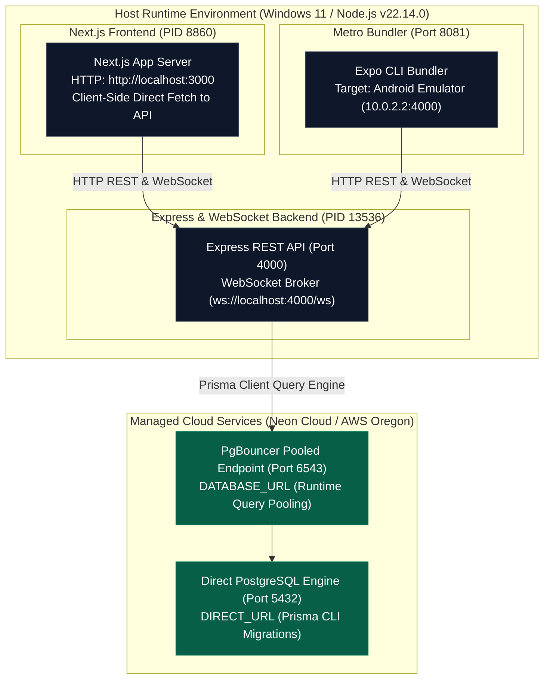
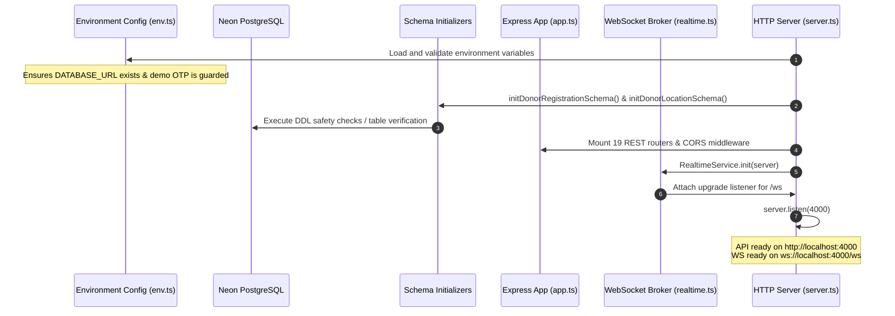

# RaktaSetu — Deployment & Runtime Architecture

## 1. Physical Deployment Topology

---

## 2. Process Tree & Port Allocation

| Component / Subsystem | Runtime Process Command | Operating Port | Protocol | Process State |
|---|---|---|---|---|
| **Next.js Web Portal** | `next dev` (`npm run dev:web`) | `3000` | HTTP / HTML / SSE | **Active & Running** (PID 8860) |
| **Express API Backend** | `tsx watch src/server.ts` (`npm run dev:api`) | `4000` | HTTP/1.1 REST | **Active & Running** (PID 13536) |
| **WebSocket Realtime Broker**| Integrated in `server.ts` | `4000` (`/ws`) | WSS / RFC 6455 | **Active & Listening** |
| **Metro Mobile Bundler** | `expo start` (`npm run dev:mobile`) | `8081` | HTTP / Metro HMR | Configured & Testable |
| **Neon PostgreSQL Database** | Managed Serverless Cloud | `6543` / `5432` | TCP PostgreSQL Wire | **Online (Neon AWS Oregon)** |

---

## 3. Database Connection Pooling Strategy

RaktaSetu connects to Neon Cloud PostgreSQL using a dual-connection string configuration in [`apps/api/src/config/env.ts`](file:///d:/MyProject/RaktSetu/apps/api/src/config/env.ts):

1. **Pooled Connection (`DATABASE_URL`):**
   - Connects through Neon's serverless connection pooler (PgBouncer) on port 6543.
   - Handles thousands of concurrent short-lived HTTP API requests without exhausting database backend connection limits.
   - Enforces SSL encryption via `?sslmode=require&pgbouncer=true`.
2. **Direct Connection (`DIRECT_URL`):**
   - Bypasses PgBouncer and connects directly to PostgreSQL compute on port 5432.
   - Required for Prisma schema migrations (`prisma migrate dev`) and schema push operations that utilize session-level advisory locks.

---

## 4. System Startup & Dependency Sequence

